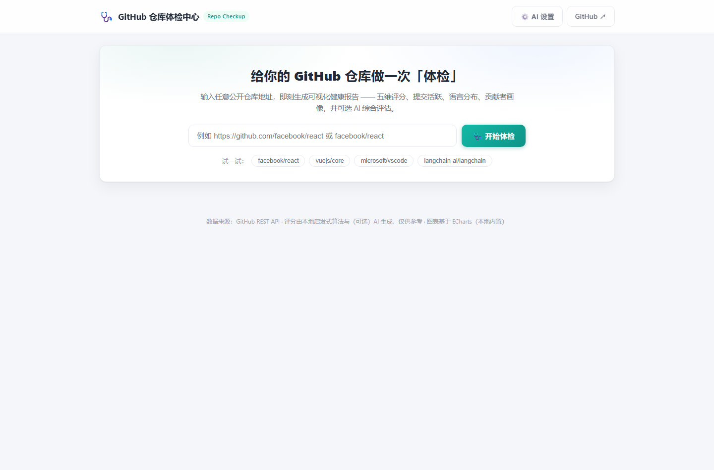
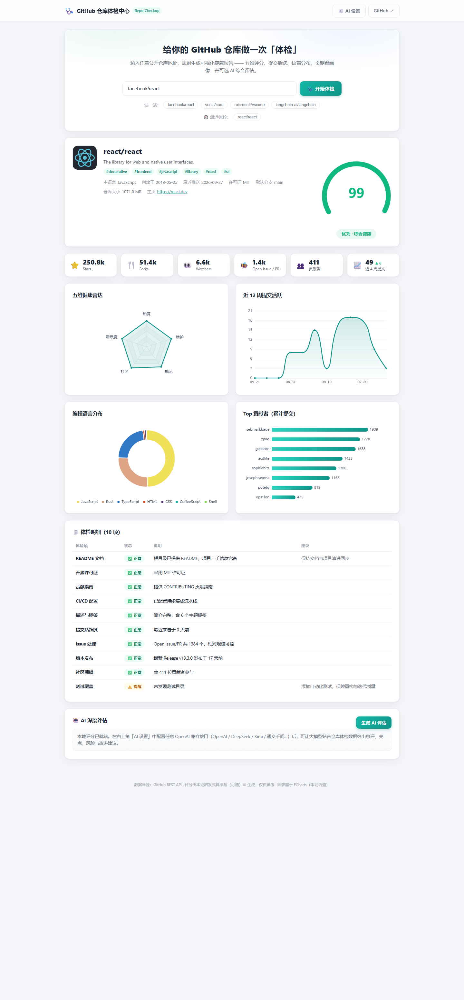

# 🩺 GitHub 仓库体检中心（Repo Checkup）

输入任意 **公开 GitHub 仓库** 地址，一键生成可视化「体检报告」：热度、活跃度、社区、规范、维护五大维度评分与综合健康分，配合丰富的图表与 10 项体检明细；并支持接入 **AI 大模型** 给出深度评估（加分项）。

## ✨ 功能特性

- 🔍 **一键体检**：支持完整 URL / `owner/repo` / `git@github.com:owner/repo.git` 多种输入格式
- 📊 **可视化报告**（ECharts 5，本地内置、无需外网 CDN）：
  - 综合健康分仪表盘 + 四档评级（优秀 / 良好 / 一般 / 需关注）
  - 五维健康雷达（热度 / 活跃度 / 社区 / 规范 / 维护）
  - 近 12 周提交活跃趋势、编程语言分布、Top 贡献者
  - Stars / Forks / Watchers / Open Issue / 贡献者 / 近 4 周提交（含环比趋势）
- 🧾 **10 项体检明细**：README、开源许可证、贡献指南、CI/CD、描述与标签、提交活跃度、Issue 处理、版本发布、社区规模、测试覆盖 —— 每项含状态（正常 / 提醒 / 异常）与改进建议
- 🤖 **AI 深度评估**（加分项）：兼容任意 OpenAI 格式接口（OpenAI / DeepSeek / Kimi / 通义千问…），输出总评、五维分、亮点、风险、改进建议；未配置 Key 时自动使用本地启发式评分，核心功能开箱即用
- 🪶 **零依赖**：仅使用 Node.js 内置模块，**无需 `npm install`**，一条命令启动
- ⚡ 内置 5 分钟分析缓存，节约 GitHub API 配额；支持 `GITHUB_TOKEN` 提升限额
- 🔗 支持 URL 直达：`http://localhost:3000/?repo=owner/repo`

## 🚀 运行方式

**环境要求**：Node.js ≥ 18（使用了内置 fetch）。无任何第三方依赖。

```bash
cd github-repo-checkup

# 直接启动（推荐）
node server.js

# 或者：需要时以环境变量启动
#   Windows PowerShell
$env:GITHUB_TOKEN="ghp_xxx"; node server.js
#   Linux / macOS
GITHUB_TOKEN=ghp_xxx node server.js

# 或者：把 .env.example 复制为 .env 并填入配置，直接 node server.js 即可
# （服务端启动时会自动加载项目根目录的 .env，无需额外参数，Node 18+ 均可用）
```

启动后浏览器打开 👉 **http://localhost:3000**

输入仓库地址（如 `https://github.com/facebook/react`）或直接点击示例仓库即可体检。
也可用 URL 直达：`http://localhost:3000/?repo=facebook/react`

## 📸 界面预览

| 首页 | 体检报告 |
| --- | --- |
|  |  |

## ⚙️ 配置（全部可选）

复制 `.env.example` 为 `.env`，或以环境变量方式设置：

| 环境变量 | 说明 |
| --- | --- |
| `PORT` | 服务端口，默认 `3000` |
| `GITHUB_TOKEN` | GitHub Personal Access Token。**建议配置**：未认证限额 60 次/小时，配置后 5000 次/小时（公开仓库只读，无需勾选任何权限） |
| `GITHUB_API_BASE` | GitHub API 地址，默认 `https://api.github.com`（网络受限可指向代理/镜像） |
| `OPENAI_API_KEY` | AI 评分使用的 API Key（服务端兜底配置） |
| `OPENAI_BASE_URL` | OpenAI 兼容接口地址，默认 `https://api.openai.com/v1` |
| `AI_MODEL` | 模型名，默认 `gpt-4o-mini`（DeepSeek 可用 `deepseek-chat` 等） |

> AI 配置也可以在页面右上角「⚙️ AI 设置」中填写（仅保存在浏览器本地，只发送给你本机运行的服务端）。页面与服务端同时配置时，页面配置优先。

## 🧮 评分模型（本地启发式）

| 维度 | 权重 | 主要依据 |
| --- | --- | --- |
| 热度 | 20% | Stars / Forks（对数刻度） |
| 活跃度 | 25% | 最近推送时间 + 近 4 周提交频次 |
| 社区 | 15% | 贡献者规模 + Issue 互动 |
| 规范 | 20% | README / LICENSE / CONTRIBUTING / CI / 描述标签 / 测试 |
| 维护 | 20% | 推送新近度 + Release 节奏 + Issue 积压率 |

综合分 ≥80 优秀、≥65 良好、≥50 一般、<50 需关注。
AI 评估则由大模型基于上述体检数据复核，给出定性与改进建议（见 `lib/ai.js`）。

## 📁 目录结构

```
github-repo-checkup/
├── server.js                  # 零依赖 HTTP 服务：静态资源 + GitHub 代理 + AI 代理
├── lib/
│   ├── score.js               # 本地启发式评分引擎（五维评分 + 10 项体检明细）
│   └── ai.js                  # AI 评分封装（OpenAI 兼容）
├── public/
│   ├── index.html             # 页面结构
│   ├── css/style.css          # 样式（浅色 / 体检报告风格）
│   ├── js/app.js              # 前端逻辑与 ECharts 渲染
│   └── vendor/echarts.min.js  # 本地内置 ECharts 5.5.1（无需 CDN）
├── tests/
│   └── score.test.js          # 评分引擎单元测试（Node 内置 test runner）
├── .github/workflows/ci.yml   # GitHub Actions：语法检查 + 单测 + 冒烟测试
├── docs/screenshots/          # 运行截图
├── .env.example               # 环境变量模板
├── PROMPTS.md                 # Vibe Coding 提示词记录
├── package.json
└── README.md
```

## 🧪 开发与测试

零第三方依赖，测试使用 Node.js 内置 test runner（Node 18+）：

```bash
# 语法检查
node --check server.js && node --check lib/score.js && node --check lib/ai.js

# 运行单元测试（评分引擎）
node --test tests/score.test.js
```

推送到 GitHub 后，`.github/workflows/ci.yml` 会自动执行同样的三步检查（语法 → 单测 → 启动冒烟测试）。

## 🔌 API 说明

| 接口 | 方法 | 说明 |
| --- | --- | --- |
| `/api/analyze?url=<仓库地址>` | GET | 分析仓库：基础信息、语言分布、贡献者、提交活跃、五维评分、10 项体检明细 |
| `/api/ai-score` | POST | body：`{ "report": <analyze 返回的 report>, "config": { baseURL, apiKey, model }? }`，返回 AI 评估 JSON |
| `/api/health` | GET | 健康检查：服务状态与 GitHub Token 配置情况 |

## ❓ 常见问题

- **提示「GitHub API 限流」**：未认证限额 60 次/小时，配置 `GITHUB_TOKEN` 即可解决（5000 次/小时）；服务端内置 5 分钟缓存可缓解重复查询。
- **访问 GitHub 超时**：检查网络/代理；可通过 `GITHUB_API_BASE` 指向可用的 GitHub API 代理。
- **AI 按钮报错**：检查「AI 设置」中的 Base URL / Key / 模型名；服务端控制台会输出具体错误信息。
- **Open Issues 数比预期多**：GitHub 该字段包含 PR，报告中已注明「Open Issue / PR」。

## 🧠 Vibe Coding

本项目由 AI Coding 工具以对话方式从零生成，提示词记录见 [PROMPTS.md](PROMPTS.md)。

## License

MIT
